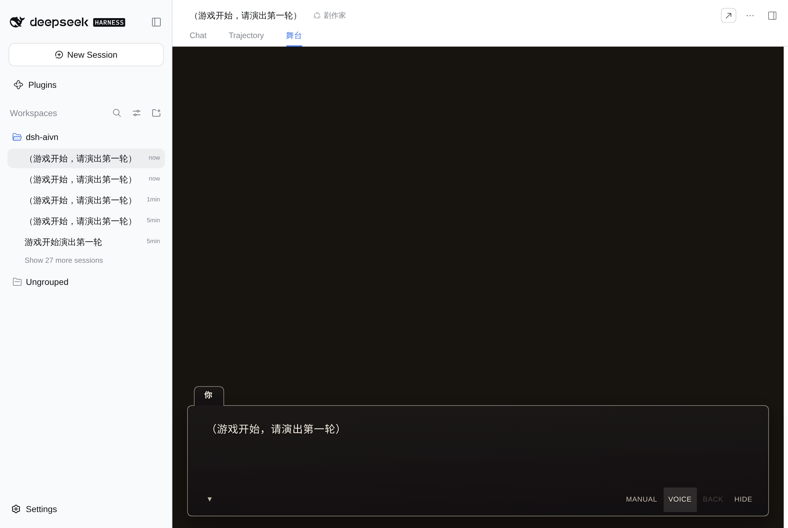

# dsh-aivn

<p align="center">
  <a href="./README.md"><strong>简体中文</strong></a> ·
  <a href="./README.en.md"><strong>English</strong></a>
</p>

把 AIVN 的舞台引擎装进 DSH。

一个**工作区就是一部剧目**：在里面开会话、选「剧作家」预设，对话页就多一个「舞台」tab，
剧作家写的 Stage DSL 被实时演出来——背景、立绘、台词条、停止点选项都在这里；玩家点一条选项，
这句话回到剧作家手上，它接着往下写。



## 装

包是 DSH 的 bundle（`package.json` 里声明了 `dsh.bundle.patch`）：

```bash
dsh plugin --profile web add dsh-aivn
```

从 GitHub 直装也行——`lib/` 是**跟踪的构建产物**，所以不需要构建脚本、也不会触发
pnpm 的 `allowBuilds` 拦截：

```bash
dsh plugin --profile web add github:john-walks-slow/dsh-aivn
```

- **手工挂**：在 profile 的 `cordis.patch.yml` 里加一行：

```yaml
- insert:
    - id: dsh-aivn
      name: dsh-aivn
      config: {}
```

- **客户端半边**（「舞台」tab）挂在 `conversation.view` 槽上，需要 `dsh-web-app`。它在
  `package.json` 的 `dsh.client{platform:"web"}` 里声明，不走 Loader。

可配的有三处——**语音**、**搭台助手的命令行**、**联网检索**；都不配也能照常跑（只是那项能力没有）：

```yaml
- id: aivn
  name: dsh-aivn
  config:
    tts:
      keys: ["<your-fish-audio-key>"]   # 多把可轮询，摊免费额度
      baseUrl: https://api.fish.audio    # 默认值，一般不用写
      model: s2.1-pro-free               # 默认值
      concurrency: 2                     # 同时合成的上限
    search:
      keys: ["<your-exa-key>"]           # 多把可轮询；给了它搭台助手才有 web_search
      baseUrl: https://api.exa.ai        # 默认值
    shell: false                         # true = 给搭台助手放开 bash
    image:                               # 配了它两个角色才会出图
      format: gemini                     # gemini | openai | modelslab（接口格式，不是产品名）
      baseUrl: http://127.0.0.1:38000    # 本机 flow2api；官方 API 或别的网关填它自己的地址
      model: gemini-3.1-flash-image
      size: 1K                           # 1K / 2K / 4K（K 大写），或字面像素 1536x1024
      apiKey: ""                         # 本机网关不校验就留空（留空 = 不带鉴权头）
      timeoutMs: 180000
    music:                               # 配了它搭台助手才有 generate_bgm
      baseUrl: http://127.0.0.1:38000
      model: flow-music-lyria-3.5
      apiKey: ""
      timeoutMs: 240000
```

| 配置项 | 默认 | 给了会怎样 | 环境变量兜底 |
|---|---|---|---|
| `tts.keys` | 空 | 舞台有语音开关，搭台助手多一个 `list_voices`（音色库与合成共用这池 key） | `DSH_AIVN_TTS_KEYS` |
| `tts.baseUrl` / `tts.model` / `tts.concurrency` | Fish 官方 / `s2.1-pro-free` / `2` | — | — |
| `search.keys` | 空 | 搭台助手多一个 `web_search`（一次调用同时拿回结果与正文） | `DSH_AIVN_EXA_KEYS` |
| `shell` | `false` | 搭台助手的预设里那一行 `tool-bash` 真装上（默认关，与 AIVN 的 `defaultOff` 同口径） | — |
| `image.format` / `image.baseUrl` / `image.model` | — | **地址与模型都给齐**才有生图：搭台助手多 `generate_image` / `commit_asset` / `recut_sprite`，剧作家多一个**同步**的 `generate_image`。格式是接口协议形状，不是产品名 | — |
| `image.size` | `1K` | 档位 `1K`/`2K`/`4K`（K 大写）或字面像素 `1536x1024`；gemini 格式只认档位，openai/modelslab 两种都收（modelslab 封顶 1024） | — |
| `image.apiKey` / `image.timeoutMs` | 空 / `180000` | 本机网关不校验就把 key 留空（不带鉴权头）；出图慢就把超时调大 | — |
| `music.baseUrl` / `music.model` | — | 都给齐才有 `generate_bgm`（只有 Gemini 形状，没有 `format`） | — |
| `music.apiKey` / `music.timeoutMs` | 空 / `240000` | 同上；一首曲子实测约 84 秒 | — |
| 抠底调参 | 见「素材生成」 | `DSH_AIVN_CUTOUT_TOLERANCE` / `_KEY_SMOOTH` / `_EDGE_BAND` / `_SPILL` / `_SOLID_RESIDUAL` 五个环境变量 | 同名环境变量 |

key 两处都没有 = 那项能力停用：工具**不注册**、提示词里也不提。两个预设、一条 `/new-play` 命令、
`/aivn` 路由都是固定的，不可配。**改配置要重启 dsh**：能力面在装载时定值（预设与工具行都按它拼）。

> 开发期 `@aivn/core` 与 `@aivn/stage` 走 `file:` 依赖（指向 stage-ai 仓库）。发布版换成版本号。

## 用

1. 新建会话，在座位 chip 上选 **剧作家**（备料的那位是 **搭台助手**）。
   预设是**在会话开始时**定下的，中途换不了——想换就新建一个会话。
2. 会话的工作目录根要有 `play.json`。没有的话舞台会明说「这个会话的工作目录里没有 play.json，
   还不是一座剧目」——那就先把它立起来，见下。
3. 说一句话，或者切到「舞台」tab 点「开演」。之后的一切都在舞台上发生。

「舞台」tab 是会话头部的第四个 tab（Chat / Trajectory / 舞台）。

### 起一座新剧目

工作区里没有 `play.json` 就是「这还不是一座剧目」。两条入口，写出来的东西一模一样：

- **人**：输入框敲 `/new-play 雨中的旧校舍`。不给剧目名就取工作目录名。
- **Agent**：`create_play` 工具，两个预设都装着它。

两者都**只写不存在的文件**：`play.json` 已经在那儿就直接报错（这里已经是一座剧目，
要起新的就换一个空目录开会话），`memory/always/premise.md` 与角色卡已经写好就跳过、
在回执里列成「保留」。落下的骨架就是下面那张目录表里的前几行——之后缺什么补什么。

## 一部剧目长什么样

工作目录根就是剧目根：

```
play.json                          剧目配置（唯一的必填文件）
memory/always/premise.md           世界观前提
memory/always/craft.md             文风与禁忌（散文，只能拿话说）
memory/always/state/scene.md       当下场景（剧作家自己写）
memory/always/state/threads.md     未了线索（剧作家自己写）
characters/<id>.md                 角色卡
assets/backgrounds/…               背景
assets/cg/…                        插图
assets/sprites/<id>/…              立绘：每个主体一个目录
assets/sfx/…  assets/bgm/…         音效与音乐
assets/manifest.json               素材描述表：素材 id → 一句话画面
```

### play.json

必需字段只有两个：

```json
{ "id": "my-play", "title": "我的剧目" }
```

其余字段（全部可选）：

| 字段 | 作用 |
| --- | --- |
| `opening` | 开局那条 user 消息的正文。舞台上的「开演」和「继续」发给剧作家的就是它。缺省 `（游戏开始，请演出第一轮）` |
| `characters` | `[{ id, name }]`。**只用来给台词条配名字**：立绘绑定在角色卡的 frontmatter 上 |
| `craft` | 写作参数，见下 |
| `initialState` / `initialScene` | 剧目的起始状态与起始场景 |
| `scriptLanguage` | 剧本语言（ISO 639-1）。缺省跟随玩家说什么话 |
| `voiceLanguage` / `defaultVoiceId` / `cover` | 语音与封面：属于 AIVN app，本插件当前不读 |
| `image` / `agents` | 生图与 agent 运行设置：属于 AIVN app，本插件当前不读 |

### characters/&lt;id&gt;.md

一张角色卡就是一份 Markdown，可选 frontmatter：

```markdown
---
name: 林
sprite: lin
voice: 短句，少用形容词
---

十七岁，话少，习惯先看窗外再看人。
```

- `name` —— 台词条上的名字。
- `sprite` —— 绑到哪个立绘目录（`assets/sprites/<sprite>/`）。不写就是角色自己的 id。
  立绘是**立绘自己的事**：`characters/` 可以没有立绘，`sprites/` 也可以没有卡。
- `body` —— 人设正文。

### assets/manifest.json

剧作家认 id 认不出画面，靠这份描述：

```json
{
  "veranda": { "description": "黄昏时分的走廊，木地板反着暖光" },
  "lin/normal": { "description": "林，常服，平静的神色" }
}
```

**键是素材 id，不是路径**——不带目录前缀，也不带扩展名。写成 `backgrounds/veranda.png`
不会报错，只是永远匹配不上，剧作家会以为这件素材没有描述。三种键形：

| 素材 | 键 |
| --- | --- |
| 背景 / 插图 / 音效 / 音乐 | 文件名去掉扩展名（`veranda`） |
| 立绘（整主体） | 立绘目录名（`lin`） |
| 立绘（单个差分） | `<立绘目录名>/<差分名>`（`lin/normal`） |

值里除了 `description` 还能写 `tags`、`title`、`framing`、`stature`、`anchor`
（立绘摆位），音乐还能写 `mood`、`scene`、`durationSec`、`loop`、`volume`。

背景、插图、音效、音乐按扩展名白名单收（png/jpg/jpeg/webp/mp3/ogg/wav/m4a）；立绘按
`sprites/<主体id>/` 分目录，每个目录里的第一个文件是找不到指定差分时的兜底。

### craft：写作参数

`play.json` 的 `craft` 段，三个字段都可不写（不写 = 引擎默认）：

| 字段 | 取值 | 默认 |
| --- | --- | --- |
| `beatLength` | `short` / `medium` / `long` | `medium` |
| `stopOptions` | `two` / `three` / `four` / `free` | `three` |
| `assets.background` | `library-first` / `library` / `generate` | `library-first` |
| `assets.cg` | `library` / `generate` / `off` | `generate` |
| `assets.sprite` | `generate` / `off` | `generate` |
| `assets.audio` | `library` / `off` | `library` |

`free` = 固定停在自由输入框，不给选项面板。

**素材来源四类目前只是意向**：这一阶段没有生图、也没有跨剧目素材库，四类素材一律只能用
手工放进 `assets/` 的那些。文风、禁忌、称呼习惯这类只能拿话说的口径写在
`memory/always/craft.md`，不在 `play.json` 里。

剧作家用 `set_craft` 工具改写这一段（只动 `craft` 一个键，文件里其余部分一个字节都不碰）。

## 两个预设

| id | 名字 | 干什么 |
| --- | --- | --- |
| `aivn-playwriter` | 剧作家 | 实时写 Stage DSL 的那位；它的输出被接进舞台 |
| `aivn-stagehand` | 搭台助手 | 备料：写设定、角色卡、创作口径、挑音色、出图与入库、配乐、查资料 |

两个预设的行集同构：指令文件发现（`AGENTS.md`）+ persona（就是那份提示词）+ 文件工具 +
文件检索。**搭台助手另加两样**：技能库（自带的 `skills/`，见下）与一行默认关的 `tool-bash`
（`shell: true` 才真装上）。剧作家两样都没有——写戏、读文件用不上。**预设里不会再列一行
`dsh-aivn`**——宿主已经装了本插件，再来一行会把路由与事件订阅重复装一遍。

只有剧作家预设的会话会进舞台管线。搭台助手说什么都不上台。

### 技能库（搭台助手）

插件自带两份做法速查，随包发布（`skills/`），装进搭台助手的会话：

| 技能 | 讲什么 |
| --- | --- |
| `galgame-audio` | 免费 BGM / 音效去哪里找、哪档授权能商用、六大场景与常见音效类别的选源、再分发与 AI 训练红线 |
| `galgame-visual-craft` | 画风锚点写在哪、角色外形怎么锁（头身比 / 五官 / 服装）、差分布局与命名、图单怎么写、可直接粘贴的生图提示词写法 |

清单进 system prompt（只列名字与一句话），模型觉得对上了才加载全文——两份都是长篇，不该每轮全读。
`includeDefaultRoots: false` 是刻意的：宿主上那几十个本机运维技能不该挤进搭台助手的清单。

## 上下文注入

剧作家的系统提示词由两部分拼成，中间夹着**每轮注入的剧目上下文**——剧作家不需要自己去
`ls` + `read` 一圈就知道这部戏的设定、有谁、有什么素材、现在演到哪儿：

| 段 | 内容 | 来源 |
| --- | --- | --- |
| 静态前半 | 身份、怎么工作、剧目在哪 | `persona` 的 `prefix` |
| 《剧本语言》 | 正文用哪种语言写 | `play.json` 的 `scriptLanguage` |
| 《剧目设定》 | 世界观前提 | `memory/always/premise.md` |
| 《角色表》 | 每张卡的正文 + 音色 + 立绘差分；只有立绘没有卡的主体单列一节 | `characters/*.md` |
| 《素材清单》 | 背景 / 音乐 / 音效 / 插图的 id + 描述；有音乐音效时附编排规则 | `assets/` + `assets/manifest.json` |
| 《写作参数》 | 每轮多长、给几条选项、素材来源，外加创作口径散文 | `play.json` 的 `craft` + `memory/always/craft.md` |
| 《记忆索引》 | 每张设定卡一行（分类 / 标题 / 路径 / 摘要） | `memory/index/**` |
| 静态后半 | 剧本格式、记忆卡怎么写、引入新角色、演出契约 | 插件注册的尾段 |
| 【状态】 | 场景、好感度、旗标、活跃剧情线（每轮变化的 user 角色快照） | `memory/always/state/*` |

这些段**只挂给剧作家的会话**（注册在 Agent scope 上），搭台助手看不到舞台契约。
快照按秒级 TTL 缓存：一个 turn 里的多个 step 读到同一份，跨轮自然重读。
改完文件不用做别的，下一轮就生效。

**搭台助手的注入是另一套**（同样注册在它自己的 scope 上）：

| 段 | 内容 | 来源 |
| --- | --- | --- |
| 《剧本语言》 | 给演出看的内容用哪种语言写（与用户对话仍是中文） | `play.json` 的 `scriptLanguage` |
| 《当前状态》 | 剧目文件清单（路径 + 大小，三层深）+ 开演条件报告 | 工作目录 + `readiness` |

它不需要舞台契约（不写剧本），也不需要角色表那种逐条展开——它要的是「现在盘上有什么、
还缺什么」，刚写完文件下一轮就看得见。

## Agent 工具

工具跟着预设装、跟着预设卸。`create_play` 与 `list_assets` 两个预设都有；其余按角色分：

| 工具 | 谁有 | 作用 |
| --- | --- | --- |
| `create_play` | 两个预设 | 把工作区立成一座新剧目：写 `play.json`（`id`/`title`/`opening`/`characters`）、`memory/always/premise.md` 与 `characters/<id>.md`。已经有 `play.json` 就报错 |
| `list_assets` | 两个预设 | 列**这座剧目**的素材（`assets/` + `manifest.json`，外加 `characters/` 里的角色卡），可按类目与关键词过滤。**没有跨剧目的素材资源库**——列的就是这座剧目的全部家当 |
| `beat_done` | 剧作家 | 交出这一轮的停止点：给 `options` = 选项面板；给 `placeholder` = 自由输入框；都不给 = 这一轮不设停止点。调用即是「本轮到此为止」 |
| `update_state` | 剧作家 | 改剧目的运行状态：`affinity`（角色好感度增量，整数、`\|Δ\|≤5`）、`flags`、`scene`、`threads`。写进 `memory/always/state/` |
| `get_readiness` | 搭台助手 | 开演条件自查：`play.json`、故事前提、角色卡张数、立绘、背景、素材条数。**没有硬门槛**，缺什么都能开演 |
| `set_craft` | 搭台助手 | 改写 `play.json` 的 `craft` 段（每轮篇幅、停止点选项数、素材来源），见上 |
| `list_voices` | 搭台助手（配了 `tts.keys` 才有） | 查 Fish 音色库挑音色：按语言 / 标签 / 标题关键词取窗口，本地按 `gender` 筛，按热度排序出前 25 条。挑好的 id 填进角色卡的 `voice` |
| `web_search` | 搭台助手（配了 `search.keys` 才有） | 联网检索：一次调用同时拿回结果与正文。只查剧目之外的事实——设定、角色、剧情都在工作区文件里 |
| `generate_image` | 搭台助手（配了生图才有） | 出**草稿**：背景 / 插图 / 立绘都能出，立绘自动抠底。一次出几张候选让用户挑，挑中的才入库 |
| `commit_asset` | 搭台助手 | 把挑中的那张草稿正式入库：写 `assets/`、补素材表声明、记台账。**用户点头之后才调** |
| `recut_sprite` | 搭台助手 | 拿立绘**入库时留的原片**原地重抠（画面一个像素不变、不烧配额），用于「图挺好、抠得脏」 |
| `generate_bgm` | 搭台助手（配了音乐才有） | 生成一首 BGM 落 `assets/bgm/`；**同步等待**（约 84 秒），`name` 就是剧本里 `<scene bgm="…">` 引用的 id |
| `generate_image` | 剧作家（配了生图才有） | 演出中缺图：**同步等图**（70–140 秒，这一轮停在那里）、出图即入库，回执给最终路径——回执回来之后那一行剧本才引用得到它 |

`list_voices` / `web_search` 在没配 key 时**不注册**，提示词里也不提它们——不会教模型去调一个
不存在的工具。文件工具（`read` / `write` / `edit` / `glob` / `grep` / `read_image`）由预设的行集提供，
两个预设都有：搭台助手用 `read_image` 看画、看用户放进来的图。

## 素材生成

配了 `image` 之后，两个角色都能出图；**同一份实现、两种等待策略**：

| | 搭台助手 | 剧作家 |
| --- | --- | --- |
| 流程 | **两步**：`generate_image` 出草稿 → 用户挑 → `commit_asset` 入库 | **一步**：`generate_image` 同步等图、出图即入库 |
| 为什么要这样 | 一次出三张候选，没被挑中的不该在素材表里留下痕迹 | 演出中缺图就当场补，调用本身就声明了最终 id |

剧作家这一侧是**同步**的（一次 70–140 秒，这一轮就停在那里）。AIVN 那边是后台排产 + 到货广播，
插件是 DSH 会话模型、没有回合之外的注入通道，所以宁可等——至少回执说的是真话：模型拿到回执时，
那个素材 id 确实已经在盘上、这一轮就引用得到。

### 目录与台账

```
play/
├── assets/                       ← 剧目素材，进 git
│   ├── generated.json            ← 出图台账：每张图当初用的 prompt（只增，不覆盖别人的键）
│   └── manifest.json             ← 素材描述与立绘呈现声明（framing / stature / title）
└── media-cache/                  ← 中间物，不进 git，整目录删掉不心疼
    ├── drafts/<草稿id>/{image.*, source.*, draft.json}
    ├── sprite-sources/<主体id>/  ← 立绘抠底前的原片（recut_sprite 只认它）
    └── tts/                      ← 语音缓存（内容寻址）
```

草稿留 7 天，由下一次出图顺手清掉。`.gitignore` 建议至少加一行 `media-cache/`
（`assets/` 要进 git——那是剧目内容）。

### 候选图怎么给用户看

不新增 HTTP 路由：**回执与回复里贴 markdown 图片，路径是工作区内的绝对路径**
（``）。DSH 的对话界面会把它渲染成
内联预览（点开有大图），草稿与素材都在会话工作区（= 剧目根）里，所以这条路对草稿与入库后的
素材一样有效。工具回执里直接给好这一行，persona 要求模型把它贴进回复——「出 3 张候选让用户挑」
这条流程的前提就是用户真的看得见那三张。

### 立绘：取景、体量与抠底

- **取景 `framing`** 决定出图画幅与舞台摆位：`full` 9:16 / `half` 3:4 / `square` 1:1。
  人物用 `full` 或 `half`，猫、道具这类非人主体用 `square`（「全身/半身」是给人形用的词）。
  同一个主体要保持同一档，声明写进 `assets/manifest.json` 的 `<主体id>` 键。
- **体量 `stature`**（`small` / `normal` / `large` / `huge`）只管台上站多大，与取景是两件事：
  机甲是「全身取景 + 巨大」，猫是「方形取景 + 小」。
- **抠底自动**：立绘出完会跑一遍色键抠底（`src/media/cutout.ts`，纯色底 + 全局色键 + 边缘覆盖率
  反解），落成透明 PNG。抠不干净时**不要重新出图**——重画出来是另一张画，用 `recut_sprite`
  拿留底原片原地重抠，五档调参对应五个环境变量：

| 环境变量 | 默认 | 作用 |
| --- | --- | --- |
| `DSH_AIVN_CUTOUT_TOLERANCE` | `48` | 色键容差。**调大 = 抠得更狠**，也会连发丝一起啃掉 |
| `DSH_AIVN_CUTOUT_SPILL` | `20` | 限色：压掉边缘残存的底色（发丝一根不少）。边上还有底色残留先调它 |
| `DSH_AIVN_CUTOUT_EDGE_BAND` | `4` | 反解带宽，边缘出现硬白圈时加 |
| `DSH_AIVN_CUTOUT_KEY_SMOOTH` | `0.8` | 色键降噪：源图 JPEG 环纹在轮廓上啃出缺口时加 |
| `DSH_AIVN_CUTOUT_SOLID_RESIDUAL` | `48` | 实心判据。描边被吃掉时**调小**它 |

### 三种生图格式差在哪

| `format` | 端点 | 垫图 | 尺寸 |
| --- | --- | --- | --- |
| `gemini` | `/v1beta/models/{model}:generateContent` | ✅ 多张（`inlineData`，官方 / flow2api / cpa 都认） | 只认档位 `1K`/`2K`/`4K` |
| `openai` | `/v1/images/generations` | ❌ 这个接口没有参考图入参，带垫图直接报错 | 字面 `WxH`（档位由插件算，守住官方上限） |
| `modelslab` | `/images/text2img` 与 `/img2img` | ✅ 一张（先传 `base64_to_url` 换托管链接） | 单边封顶 1024，档位按长边顶满 |

**垫图是角色一致性的唯一可靠手段**：非 `neutral` 的立绘自动垫该主体已入库的 `neutral` 定妆照
（prompt 措辞锁不住脸）。所以同一个主体的差分顺序是：先出定妆照、挑一张入库，再派生别的差分。
**哪个格式拿不到 2K，立绘的抠底锯齿就只能靠分辨率压**——要高质量立绘就用 `gemini`。

## 斜杠命令

| 命令 | 作用 |
| --- | --- |
| `/new-play [剧目名]` | 把当前工作目录立成一座剧目。与 `create_play` 工具同一份实现，不花 LLM 往返 |

命令对所有会话可见（DSH 的命令不分预设），在哪个会话里敲就在那个会话的工作目录里落地。
它**只新建、从不覆盖**：已经有 `play.json` 就报错，其余骨架文件已存在就跳过并列进回执。

## 宿主 HTTP 面

浏览器半边只跟这几个口说话，全部按会话分频：

| 路由 | 说明 |
| --- | --- |
| `GET /aivn/health` | `{ ok: true, plugin: "dsh-aivn" }` |
| `GET /aivn/play?session=` | 这个会话的剧目：`{ dir, config, voice }`；不是剧目就是 `{ dir: null, voice: false }`。`voice` 说明宿主配没配 TTS，客户端据此决定显不显示语音开关 |
| `GET /aivn/assets?session=` | `{ index, manifest }`；不是剧目 404 |
| `GET /aivn/asset?session=&path=` | 剧目内的一件素材。`path` 是**相对剧目根**的路径（如 `assets/backgrounds/x.png`），越界 400 |
| `GET /aivn/audio?session=&file=` | 一句台词的合成音频。文件名是 `sha1(模型 + 音色 id + 文本)`，内容寻址，所以可以长缓存 |
| `GET /aivn/stream?session=` | SSE，`event: frame`，data 是一帧 `StageFrame` JSON。连上先补推已经播过的帧，15 秒一次 keepalive |
| `POST /aivn/input { session, text, silent? }` | 玩家的一次输入，投给剧作家。`silent: true` = 不算玩家说的话（舞台的「继续」走这条），仍然会作为一条 user 消息投出去 |
| `POST /aivn/voice { session, enabled?, paused? }` | 语音总开关与客户端背压。`enabled: false` 让服务端停止分句合成（省额度），`paused` 是播放层积压时的临时背压 |

`StageFrame` 有三种：

```ts
{ seq, kind: 'ir',   event: StageEvent }   // DSL 解析出的 IR
{ seq, kind: 'beat', state: 'start' | 'end' }  // 剧作家起笔 / 停笔
{ seq, kind: 'voice', lineSeq, phrase, state: 'started' | 'ready', url? }  // 语音
```

**语音跟着播放头的节奏走**：一句台词的音频要 2–5 秒才合成回来（Fish 免费模型的实测值），
而舞台是手动推进的——停在这一句上的时间够长就听得到，点太快点过去的那一句会被丢弃
（这是引擎本来的设计：不给已经翻过去的行补声音，免得和下一句叠在一起）。
播放层的「重听这句」是对应这条的补法。

合成的音频落在剧目自己的 `media-cache/tts/`：文件名是 `sha1(模型 + 音色 id + 文本)`，内容寻址，
所以重连补推、快进回看、重听都命中同一份、不会再打一次上游。这份缓存**只增不减**（换了模型或改了
一个字就是新文件），随时可以整个目录删掉，下次演出会重新合成。

`voice` 帧的 `lineSeq` 是**那一行 `say_start` 帧的 seq**（不是本帧的 seq）——音频按它挂回台词行。
`started` 用来让喇叭亮起来（还在合成），`ready` 带上可播的 URL。台词与音频是并行出的：
文字先上屏，声音好了接上，接不上就静音演完（合成失败只打一行告警，不阻塞演出）。

**玩家输入不在这条流里由路由写入**：`/aivn/input` 只负责投递，落点只有一处——宿主监听
`agent/inbox/inserted`，于是 DSH 原生输入框与舞台的选肢卡走同一条路，既不会各写一条，也不会漏写。
引擎自己投的那些（追收束的内部指令、`silent` 的空推进）也走这条路，按 `message.id` 认出来摘掉，
不会变成一行玩家台词。

`/aivn/*` 是插件自己注册的前缀路由，**在 DSH 的浏览器信任栅栏之外**（那道栅栏只管 `/api`）：
`POST /aivn/input` 只收同源请求（`Origin` 与 `Host` 对不上就 403）且要求
`content-type: application/json`，免得跨站页面替玩家投一句输入。

## 权限与兼容

- **网络**：出网只有四处——配了 TTS key 时打 Fish Audio（`api.fish.audio` 或你配的 `baseUrl`，
  音色库查询与语音合成共用），配了 `search.keys` 时打 Exa（`api.exa.ai` 或你配的 `baseUrl`），
  配了 `image` 时打生图后端，配了 `music` 时打音乐后端（后两者的地址完全由你配的 `baseUrl` 决定，
  默认不预置任何厂商地址）。四项都没配就一个请求都不发。其余功能全在本地。
- **文件**：读写在会话的工作目录（也就是那座剧目的目录）内。工具与 `/new-play` 只在你指定的
  目录里建剧目文件；语音缓存、出图草稿、立绘留底原片写在 `<剧目>/media-cache/` 下
  （都是中间物，可随时整目录删除）。不碰工作目录以外的路径。
- **命令行**：`shell: false`（默认）时搭台助手那一行 `tool-bash` 是关的，它没有命令行；
  开成 `true` 才有——那时它能跑的东西不再受文件工具的路径约束，自己权衡。
- **HTTP**：往 DSH 的 web server 注册 `/aivn/*`（剧目读写、素材、SSE 事件流、音频）。
  四个写接口都走同源 + `content-type: application/json` + 字节上限 + JSON 四道闸；
  `/aivn/audio` 只接受目录内的纯文件名（`basename` 判定 + `.mp3` 白名单），不接受任何路径。
- **密钥**：TTS 与 Exa 的 key 只从配置或环境变量读，不进日志、不进 URL、不进 git；错误文案里
  最多带上游返回的前 200 字符。
- **兼容**：宿主半边对齐 `dsh` `0.1.7-rc.2`，客户端半边对齐 `0.1.1-rc.2`。「舞台」tab 需要
  `dsh-web-app`（挂在 `conversation.view` 槽上）。

## 开发

**前置**：`@aivn/core` 与 `@aivn/stage` 现在走 `file:` 依赖，指向兄弟仓库
`stage-ai`（后者要在 `.worktrees/dsh-vn-stage` 里带 `packages/stage`）：

```
~/projects/
├── dsh-aivn/            ← 本仓库
└── stage-ai/
    ├── packages/core/                  （@aivn/core）
    └── .worktrees/dsh-vn-stage/packages/stage/   （@aivn/stage）
```

这两个包**只在构建期**用得到：esbuild 把它们打进 `lib/`，运行时不依赖。
所以**装插件的人不需要它们**（`npm i` 只装 `dependencies`），只有想从源码重建才需要。

```bash
npm install         # 需要上面那两个兄弟目录在位
npm run build       # lib/index.js（宿主半边）+ lib/client.js（浏览器半边）
npm run typecheck
```

`lib/` 是**跟踪的构建产物**：DSH 直接加载它，所以改完 `src/` 必须重建再提交。
`npm publish` 前会跑 `prepublishOnly`（重建 + 类型检查），保证发出去的和源码一致。

### e2e

```bash
dsh-e2e start --wait-ready     # 起一个最小实例（dsh-base + dsh-web-app + 本 worktree）
npm run e2e:stage              # 跑舞台套件「stage」
dsh-e2e stop
```

实例 home 在 `<worktree>/.dsh-e2e-home`，不进 git。两个本地前提（都在那个 home 里，不在仓库里）：

- **要有可用的 LLM provider**：home 的 `settings.yaml` 首次启动会被 import 后改名，此后冷启就
  没有 provider 了。把你线上 profile 里那条 provider（`llm-*`）补进
  `.dsh-e2e-home/profiles/web/cordis.patch.yml`，并 export 它用的 API key 环境变量——
  否则 GUI 会被「Add an API key to get started」挡住，会话也发不出消息。
- **默认模型挑一个你这台机器出得去的**：这份模型列表里可能有地区受限的条目（报
  `User location is not supported` 那种）。e2e 不挑具体模型，能通就行。

套件：

- `stage`（`npm run e2e:stage`）——在工作区根落一份临时剧目夹具 → 新建会话并选「剧作家」预设 →
  发一句 → 断言「舞台」tab 挂载、导演工作栏不渲染、台词逐字上屏、停止点出来、点选项后原文被投给
  剧作家并在时间线上落成一行回执、剧作家接着写完第二轮。
- `injection`（`dsh-e2e run e2e/verify-injection.mjs`）——剧作家的上下文注入：从会话日志断言
  A 区六段与【状态】都进了系统提示词、内容取自夹具文件而不是「自己去读」，并核对工具面
  （备料工具归搭台助手、素材清单叫 `list_assets`）。
- `stagehand`（`npm run e2e:stagehand`）——搭台助手：断言 persona 章节、《当前状态》注入
  （文件清单 + 就绪报告）、随包技能库两份都在技能清单里、工具面是搭台助手那一套
  （且没有剧作家的收束口）。e2e 实例**没配生图与音乐**，所以这里同时断言那两个能力的工具
  **不在**工具清单里、persona 里也**不提**它们（未配后端时不谎报能力）。
- `voice`（`dsh-e2e run e2e/verify-voice.mjs`）——真打 Fish Audio：断言 voice 帧到达、音频能取回
  且是真 MP3、**浏览器把它解成了 PCM 并真的有音源起播**（在页面里给 `AudioContext` /
  `decodeAudioData` / `AudioBufferSourceNode.start` 挂钩子，不是看帧猜的），以及语音总开关
  确实传到了宿主。跑之前要 export `DSH_AIVN_TTS_KEYS`。

截图落在 `e2e-artifacts/`（不进 git）。
